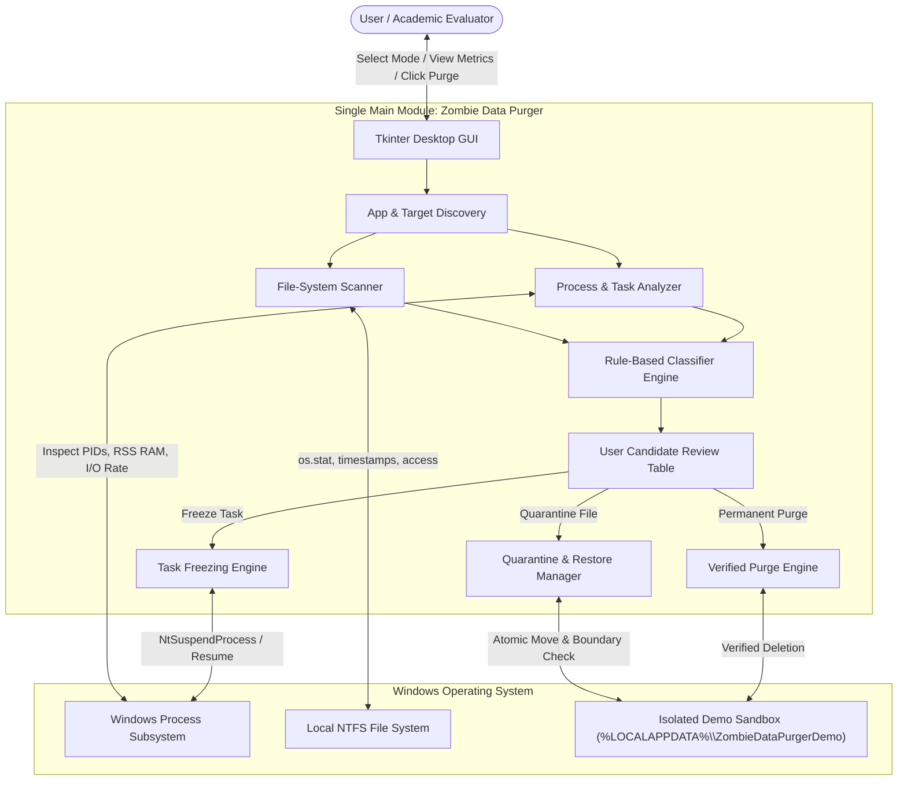
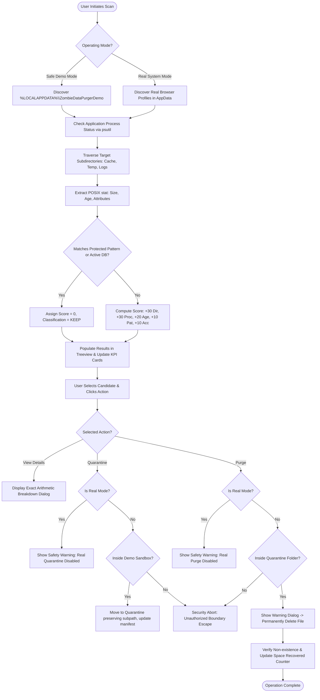
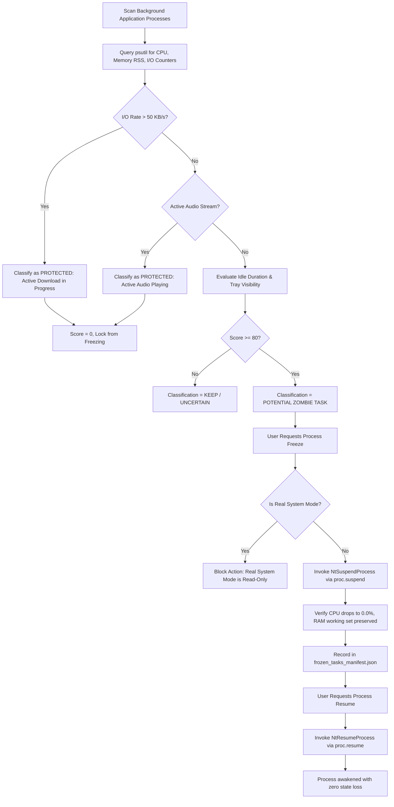
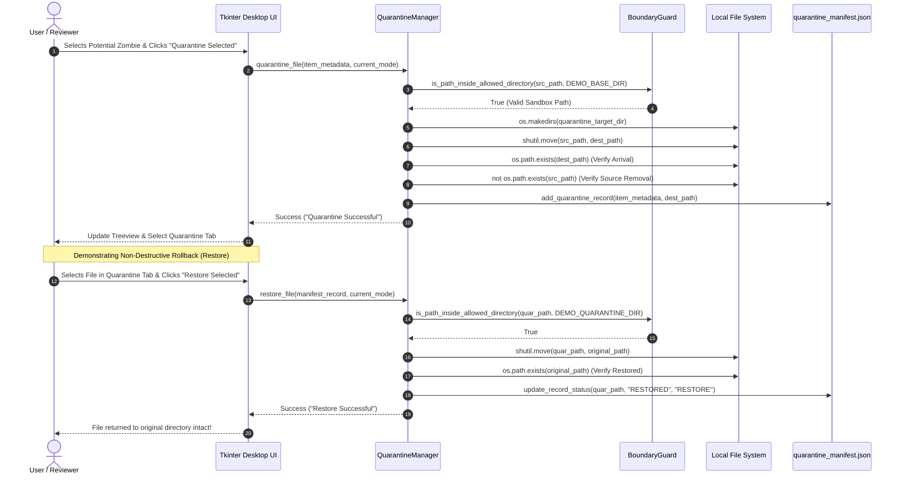

# SOFTWARE DESIGN SPECIFICATION (SDS)
> **Implementation status notice (2026-10-26):** This document preserves the earlier academic prototype specification. It contains historical process-suspension and cleanup claims that are not implemented in the current safety-first application. For current behavior, supported paths, and limitations, see `README.md` and `docs/safety_and_recovery.md`.
## PROJECT TITLE: Zombie Data Purger for Browser and Electron Applications

---

### DOCUMENT CONTROL INFORMATION
- **Project Name:** Zombie Data Purger for Browser and Electron Applications
- **Document Type:** Software Design Specification (SDS / SDD)
- **Academic Standard:** IEEE Std 1016-2009 (System Design Description)
- **Academic Module Designation:** SINGLE MAIN MODULE: `"ZOMBIE DATA PURGER"`
- **Target Operating System:** Microsoft Windows 10 / Windows 11 (64-bit)
- **Implementation Language:** Python 3.10+ (Standard Library + Tkinter GUI + psutil)
- **Version:** 2.0 (Dual Operational Facets: Storage Data Purger & Background Task Purger)
- **Status:** Approved / Academic Evaluation Baseline

---

## TABLE OF CONTENTS
1. [INTRODUCTION](#1-introduction)
   - 1.1 Purpose of the Document
   - 1.2 Scope of the System
   - 1.3 Academic Mandate: Single Main Module Architecture
   - 1.4 Definitions, Acronyms, and Abbreviations
   - 1.5 System Operational Principles
2. [SYSTEM ARCHITECTURE & HIGH-LEVEL DESIGN](#2-system-architecture--high-level-design)
   - 2.1 Layered Architectural Model
   - 2.2 High-Level System Context Diagram
   - 2.3 Dual Operating Modes Specification
   - 2.4 Safety and Zero-Corruption Architecture
3. [DETAILED SUB-COMPONENT DESIGN](#3-detailed-sub-component-design)
   - 3.1 Sub-Component 1: Application Discovery (`app_discovery.py`)
   - 3.2 Sub-Component 2: File-System Scanner & Metadata Extractor (`scanner.py`)
   - 3.3 Sub-Component 3: Process Status & Task Resource Analyzer (`process_analyzer.py`, `task_analyzer.py`)
   - 3.4 Sub-Component 4: Transparent Rule-Based Classifier Engine (`classifier.py`)
   - 3.5 Sub-Component 5: Safe Quarantine & Sub-Path Isolation Engine (`quarantine.py`)
   - 3.6 Sub-Component 6: Safe Task Suspension & Memory Reclaim Engine (`task_suspender.py`)
   - 3.7 Sub-Component 7: Sandboxed Purge Engine (`quarantine.py`)
   - 3.8 Sub-Component 8: Audit Logging & Manifest Manager (`logger.py`)
   - 3.9 Sub-Component 9: Isolated Demonstration Package (`demo/`)
4. [DATA DESIGN & PERSISTENCE SCHEMAS](#4-data-design--persistence-schemas)
   - 4.1 In-Memory Data Structures
   - 4.2 Quarantine Manifest Schema (`quarantine_manifest.json`)
   - 4.3 Frozen Task Manifest Schema (`frozen_tasks_manifest.json`)
   - 4.4 Plaintext Audit Trail Schema (`audit_log.txt`)
   - 4.5 Sandboxed Sandbox Directory Layout
5. [DYNAMIC WORKFLOW & PROCESS MODELING](#5-dynamic-workflow--process-modeling)
   - 5.1 End-to-End File Discovery-to-Purge Flowchart
   - 5.2 Task Analysis & Non-Destructive Freezing Flowchart
   - 5.3 Sequence Diagram: Quarantine and Non-Destructive Restore
6. [GRAPHICAL USER INTERFACE (GUI) DESIGN](#6-graphical-user-interface-gui-design)
   - 6.1 Layout Wireframe & Visual Hierarchy
   - 6.2 Operating Mode State Machine
   - 6.3 KPI Metric Dashboard Cards
   - 6.4 Scoring Breakdown Inspector Dialog
   - 6.5 Interactive Guided Demo Controller
7. [SECURITY, DATA INTEGRITY & EXCEPTION HANDLING](#7-security-data-integrity--exception-handling)
   - 7.1 Path Traversal Prevention (`is_path_inside_allowed_directory`)
   - 7.2 Hardcoded Protection Filters (Credentials, History, Active Databases)
   - 7.3 Zero-Corruption Process Suspension vs Forcible Killing
   - 7.4 Read-Only Hard-Lock in Real System Mode
   - 7.5 Operating System Exception Handling Matrix
8. [REQUIREMENTS TRACEABILITY MATRIX](#8-requirements-traceability-matrix)
9. [ACADEMIC VIVA DEFENSE GUIDE (ARCHITECTURAL RATIONALE)](#9-academic-viva-defense-guide-architectural-rationale)

---

## 1. INTRODUCTION

### 1.1 Purpose of the Document
This Software Design Specification (SDS) provides a comprehensive technical blueprint of the internal architecture, sub-components, data models, rule algorithms, security mechanisms, and user interfaces of the **Zombie Data Purger** desktop application. It acts as the definitive design reference for academic evaluators, reviewers, and developers.

### 1.2 Scope of the System
Modern web browsers (Google Chrome, Microsoft Edge) and Electron-based desktop clients (WhatsApp, Discord, Slack, Visual Studio Code) accumulate massive computational waste on local client workstations over extended usage:
1. **Zombie Storage Data**: Unused, orphaned disk cache chunks, obsolete shader cache, crashpad dumps, and abandoned temporary download blocks that persist indefinitely.
2. **Zombie Tasks & Memory**: Dormant processes (e.g. applications closed-to-tray, idle database instances like Oracle XE, forgotten developer servers) consuming physical RAM (working set) and CPU scheduler cycles without contributing to active user productivity.

The **Zombie Data Purger** system detects, scores, safely isolates (quarantines/suspends), and purges this computational waste with a mathematical guarantee of zero data corruption and complete sandboxed isolation.

### 1.3 Academic Mandate: Single Main Module Architecture
```
==========================================================================
                 ACADEMIC ARCHITECTURAL DECLARATION
==========================================================================
             SINGLE MAIN MODULE: "ZOMBIE DATA PURGER"
==========================================================================
Application discovery, file scanning, process status checking, rule-based
classification, quarantine, process freezing, purging, and audit logging
are NOT independent academic modules.

They are strictly designed as internal sub-components, engines, and
helper functions belonging to the single unified "Zombie Data Purger" module.
==========================================================================
```

### 1.4 Definitions, Acronyms, and Abbreviations
| Term / Acronym | Definition |
|---|---|
| **SDS** | Software Design Specification |
| **PID** | Process Identifier (unique integer assigned by Windows OS) |
| **RSS / RAM** | Resident Set Size; portion of physical RAM occupied by a process |
| **I/O Rate** | Input/Output data throughput measured in Bytes/second |
| **POSIX stat** | File system metadata structure containing `st_size`, `st_mtime`, `st_ctime` |
| **Electron App** | Desktop client built using Chromium rendering engine and Node.js runtime |
| **Potential Zombie** | Stale data/process scoring $\ge 80/100$ based on multi-indicator context |
| **NtSuspendProcess** | Windows NT Kernel executive API that halts all user threads of a process |
| **AppData** | Windows user environment paths (`%LOCALAPPDATA%`, `%APPDATA%`) |
| **Sandboxing** | Strict filesystem boundary confinement restricting writes to a test folder |

### 1.5 System Operational Principles
- **Safety First & Conservative**: Age alone **never** classifies data as zombie data. Multiple orthogonal indicators must agree.
- **Explainable Rule Scoring**: Transparent arithmetic calculation (0–100 points) where the final score is the exact sum of triggered rules. Zero black-box AI.
- **100% Offline Autonomy**: Requires 0% internet, cloud connections, external APIs, or database servers.
- **Non-Destructive Rollback**: Every isolated file or frozen process can be reverted to its pristine original state instantly.

---

## 2. SYSTEM ARCHITECTURE & HIGH-LEVEL DESIGN

### 2.1 Layered Architectural Model
The application follows a strictly decoupled 4-layer architecture:

```
+--------------------------------------------------------------------------+
|                     PRESENTATION & INTERACTION LAYER                     |
|  - Tkinter Desktop GUI (gui.py)          - KPI Dashboard Cards           |
|  - Candidate Inspection Dialogs          - Guided College Demo Assistant |
+--------------------------------------------------------------------------+
                                     |
+--------------------------------------------------------------------------+
|                  CORE ENGINE & BUSINESS LOGIC LAYER                      |
|               [SINGLE MAIN MODULE: ZOMBIE DATA PURGER]                   |
|  - Application Discovery (app_discovery.py)                              |
|  - POSIX File Scanner (scanner.py)                                       |
|  - Process & Task Analyzer (process_analyzer.py, task_analyzer.py)       |
|  - Transparent Rule Classifier Engine (classifier.py)                    |
+--------------------------------------------------------------------------+
                                     |
+--------------------------------------------------------------------------+
|                  SAFETY, ISOLATION & ROLLBACK LAYER                      |
|  - Sandboxed Quarantine & Restore Engine (quarantine.py)                 |
|  - Zero-Corruption Task Suspender Engine (task_suspender.py)             |
|  - Path Boundary Guard (utils.is_path_inside_allowed_directory)          |
|  - Protected State Retention Filter (config.PROTECTED_PATTERNS)          |
+--------------------------------------------------------------------------+
                                     |
+--------------------------------------------------------------------------+
|                     OPERATING SYSTEM INTERFACE LAYER                     |
|  - Windows Kernel Process Subsystem (psutil, tasklist, NtSuspendProcess) |
|  - Windows NTFS / FAT32 File System (pathlib, os, shutil)                |
|  - Audit Storage (quarantine_manifest.json, frozen_tasks_manifest.json)  |
+--------------------------------------------------------------------------+
```

### 2.2 High-Level System Context Diagram



### 2.3 Dual Operating Modes Specification

The system enforces an explicit dual-mode operational boundary:

```
                      +---------------------------------------+
                      |         OPERATING MODE SWITCH         |
                      +---------------------------------------+
                                  /               \
                                 /                 \
                                v                   v
          +-----------------------------+   +-----------------------------+
          |    MODE A: SAFE DEMO MODE   |   |  MODE B: REAL SYSTEM MODE   |
          +-----------------------------+   +-----------------------------+
          | - 100% Isolated Sandbox     |   | - System-Level Read-Only    |
          | - Files: %LOCALAPPDATA%\... |   | - Real Chrome, Edge, VSCode |
          | - Mock Tasks: 6 Worker PIDs |   | - Real RAM / Process Audit  |
          | - Quarantine: ENABLED       |   | - Quarantine: DISABLED      |
          | - Restore: ENABLED          |   | - Freezing: DISABLED        |
          | - Purge: ENABLED (Demo Only)|   | - Purge: HARD-LOCKED (Safe) |
          +-----------------------------+   +-----------------------------+
```

### 2.4 Safety and Zero-Corruption Architecture
1. **Zero Database Corruption via Kernel Suspension**: Rather than invoking destructive terminating signals (`SIGKILL`, `taskkill /F`) that corrupt uncommitted SQLite transactions or Oracle redo logs, the system invokes Windows kernel thread suspension (`proc.suspend()`). The memory structure remains resident in RAM or pagefile, reducing CPU consumption to 0.0%, with an instantaneous non-destructive resume capability (`proc.resume()`).
2. **Active Work Inviolability (Active Download & Audio Guard)**: Applications actively transmitting or writing data ($> 50\text{ KB/s}$) or routing real-time audio streams (calls, media) are permanently locked with Score = 0 (`KEEP`).

---

## 3. DETAILED SUB-COMPONENT DESIGN

### 3.1 Sub-Component 1: Application Discovery (`app_discovery.py`)
- **Responsibility**: Detects local application data paths and executable binaries for installed browsers, Electron clients, and demo environments.
- **Interface / Signatures**:
  - `discover_demo_applications() -> List[Dict[str, Any]]`
  - `discover_real_applications() -> List[Dict[str, Any]]`
- **Logic**: Inspects Windows `%LOCALAPPDATA%` and `%APPDATA%` directories for predefined target profiles:
  - Google Chrome: `%LOCALAPPDATA%\Google\Chrome\User Data` (Process: `chrome.exe`)
  - Microsoft Edge: `%LOCALAPPDATA%\Microsoft\Edge\User Data` (Process: `msedge.exe`)
  - Discord / Slack / VS Code: `%APPDATA%\<app>` (Processes: `Discord.exe`, `slack.exe`, `Code.exe`)

### 3.2 Sub-Component 2: File-System Scanner & Metadata Extractor (`scanner.py`)
- **Responsibility**: Recursively crawls target subdirectories (e.g. `Cache`, `Code Cache`, `GPUCache`, `Temp`, `Logs`) while handling file locking, security permissions, and file system anomalies gracefully.
- **Interface / Signatures**:
  - `scan_directories(app_name, scan_paths, process_status_info, progress_callback) -> List[Dict[str, Any]]`
- **Collected Attributes per Scanned File**:
  `{application, name, path, ext, size, ctime, mtime, age_days, parent_dir, is_cache_temp_dir, is_temp_file_pattern, is_protected, is_accessible, process_status}`

### 3.3 Sub-Component 3: Process Status & Task Resource Analyzer (`process_analyzer.py`, `task_analyzer.py`)
- **Responsibility**: Evaluates the real-time operational state of target processes on Windows.
- **Primary Mechanism**: `psutil.process_iter(['pid', 'name', 'status', 'memory_info', 'io_counters'])`.
- **Fallback Mechanism**: Native Windows `tasklist.exe /FO CSV /NH` subprocess execution if `psutil` is missing.
- **I/O Throughput Calculation**:
  $$\text{I/O Rate} = \frac{\Delta (\text{write\_bytes} + \text{read\_bytes})}{\Delta t} \quad [\text{Bytes/sec}]$$
- **Task Category Classifier**: Identifies window visibility (`GetWindowText`), foreground state, active audio output, and idle durations.

### 3.4 Sub-Component 4: Transparent Rule-Based Classifier Engine (`classifier.py`)
- **Responsibility**: Computes deterministic, explainable staleness scores ($0 \le S \le 100$) for files and running tasks.

#### Storage Data Scoring Formula:
$$S_{\text{file}} = w_{\text{dir}} + w_{\text{proc}} + w_{\text{age}} + w_{\text{pat}} + w_{\text{acc}}$$

| Metric Symbol | Rule Condition | Points Awarded |
|---|---|:---:|
| $w_{\text{dir}}$ | File resides in a known cache/temp/log directory | **+30** |
| $w_{\text{proc}}$ | Associated application executable is **NOT** currently running | **+30** |
| $w_{\text{age}}$ | File modification time exceeds threshold ($t_{\text{mtime}} \ge 30\text{ days}$) | **+20** |
| $w_{\text{pat}}$ | File matches temporary/cache/log pattern (`.tmp`, `.dat`, `.log`, `.old`) | **+10** |
| $w_{\text{acc}}$ | File is unlocked and accessible without OS contention | **+10** |
| **Max Score** | | **100** |

#### Task / Process Scoring Formula:
$$S_{\text{task}} = w_{\text{window}} + w_{\text{idle}} + w_{\text{tray}} + w_{\text{db}}$$

| Metric Symbol | Task Rule Condition | Points Awarded |
|---|---|:---:|
| $w_{\text{window}}$ | 0 visible top-level windows (closed-to-tray or headless daemon) | **+40** |
| $w_{\text{idle}}$ | Idle duration $\ge 30\text{ minutes}$ | **+30** |
| $w_{\text{tray}}$ | Background Electron/messaging client in tray | **+15** |
| $w_{\text{db}}$ | Background server process with 0 user interaction | **+15** |
| **Max Score** | | **100** |

#### Classification Tiers:
- **$80 \le S \le 100$**: `POTENTIAL ZOMBIE DATA` / `POTENTIAL ZOMBIE TASK` (Eligible for quarantine/freeze)
- **$50 \le S \le 79$**: `UNCERTAIN` (Manual review required)
- **$0 \le S \le 49$**: `KEEP` (Active application state or protected file)

#### Hardcoded Safety Protection Override:
If a file matches protected names (`Login Data`, `Cookies`, `Web Data`, `Bookmarks`, `History`, `Current Session`, `Preferences`) or is an active SQLite database (`*.db`), the score is forcefully set to **0** with classification **KEEP**.

### 3.5 Sub-Component 5: Safe Quarantine & Sub-Path Isolation Engine (`quarantine.py`)
- **Responsibility**: Atomically moves candidate files into an isolated quarantine repository while preserving relative folder hierarchy to prevent filename collision.
- **Safety Pre-Condition**: Target must resolve inside `%LOCALAPPDATA%\ZombieDataPurgerDemo\`.
- **Sub-Path Mapping**:
  $$\text{Target} = \text{DEMO\_QUARANTINE\_DIR} \cup \text{relpath}(\text{OriginalPath}, \text{DEMO\_BASE\_DIR})$$
- **Verification Guarantee**: Asserts source file non-existence and destination file presence before logging to manifest.
- **Restore Capability**: Reverses quarantine by moving the isolated file back to its exact original path.

### 3.6 Sub-Component 6: Safe Task Suspension & Memory Reclaim Engine (`task_suspender.py`)
- **Responsibility**: Freezes dormant zombie processes without termination.
- **Kernel Mechanism**: Calls `psutil.Process(pid).suspend()` which invokes Windows kernel `NtSuspendProcess`.
- **Impact**: CPU utilization drops to **0.0%**, background writes halt, and working set memory can be paged out by the OS memory manager.
- **Resume Mechanism**: Calls `psutil.Process(pid).resume()` which invokes `NtResumeProcess`, immediately awakening all process threads with zero state corruption.

### 3.7 Sub-Component 7: Sandboxed Purge Engine (`quarantine.py`)
- **Responsibility**: Executes verified permanent deletion strictly of quarantined demo files in Safe Demo Mode.
- **Boundary Validation**: Path must resolve strictly inside `%LOCALAPPDATA%\ZombieDataPurgerDemo\Quarantine\`.
- **User Confirmation**: Requires explicit two-button confirmation dialog.
- **Post-Action Verification**: Calls `os.path.exists()` to confirm deletion and updates `files_purged` and `space_recovered` metrics.

### 3.8 Sub-Component 8: Audit Logging & Manifest Manager (`logger.py`)
- **Responsibility**: Maintains an append-only transaction history in `audit_log.txt` and manages the structured `quarantine_manifest.json` and `frozen_tasks_manifest.json`.

### 3.9 Sub-Component 9: Isolated Demonstration Package (`demo/`)
- **Responsibility**: Provides a self-contained test environment for academic viva presentations.
- **Components**:
  - `demo_tasks.py`: Orchestrates 6 mock application processes simulating Chrome downloads, WhatsApp tray, Oracle XE, Node.js server, Python worker, and Spotify music.
  - `demo_worker.py`: Background worker simulating real PIDs, RAM allocations (60–200 MB), and I/O rates.
  - `demo_data.py`: Creates authentic test files with backdated modification timestamps (`os.utime`).
  - `run_demo.py`: 1-click console demonstration runner.

---

## 4. DATA DESIGN & PERSISTENCE SCHEMAS

### 4.1 In-Memory Data Structures
```python
# File Metadata Dictionary Structure
FileRecord = {
    "application": str,        # e.g., "Chrome Demo"
    "name": str,               # e.g., "old_cache_01.tmp"
    "path": str,               # Absolute path on disk
    "size": int,               # Size in bytes
    "age_days": float,         # Days elapsed since last mtime
    "is_accessible": bool,     # True if file is unlocked
    "score": int,              # 0 to 100 calculated score
    "classification": str,     # "POTENTIAL ZOMBIE DATA" | "UNCERTAIN" | "KEEP"
    "reasons_text": str        # Explicit arithmetic breakdown (+30 +30 +20...)
}

# Task Metadata Dictionary Structure
TaskRecord = {
    "role": str,               # e.g., "whatsapp_closed"
    "pid": int,                # Operating system PID
    "display_name": str,       # e.g., "WhatsApp Desktop (Closed to Tray)"
    "category": str,           # e.g., "Messaging / Tray"
    "memory_mb": float,        # RSS physical RAM in Megabytes
    "io_rate_bytes": float,    # Current disk/network write rate
    "score": int,              # 0 to 100 score
    "classification": str,     # "POTENTIAL ZOMBIE TASK" | "KEEP"
    "is_protected": bool       # True if download/audio guard active
}
```

### 4.2 Quarantine Manifest Schema (`quarantine_manifest.json`)
```json
[
  {
    "id": "Q_1728145200123",
    "original_path": "C:\\Users\\ADMIN\\AppData\\Local\\ZombieDataPurgerDemo\\Chrome_Demo\\Cache\\old_cache_01.tmp",
    "quarantine_path": "C:\\Users\\ADMIN\\AppData\\Local\\ZombieDataPurgerDemo\\Quarantine\\Chrome_Demo\\Cache\\old_cache_01.tmp",
    "application": "Chrome Demo",
    "file_name": "old_cache_01.tmp",
    "file_size": 262144,
    "modified_time": "2026-08-20 10:15:30",
    "score": 100,
    "classification": "POTENTIAL ZOMBIE DATA",
    "reason": "+30 Known cache dir\n+30 Application inactive\n+20 Older than threshold\n+10 Temporary pattern\n+10 Accessible",
    "action": "QUARANTINED",
    "timestamp": "2026-10-05 19:15:00",
    "status": "QUARANTINED"
  }
]
```

### 4.3 Frozen Task Manifest Schema (`frozen_tasks_manifest.json`)
```json
[
  {
    "pid": 15876,
    "display_name": "WhatsApp Desktop (Closed to Tray)",
    "process_name": "WhatsApp.exe",
    "memory_mb": 95.9,
    "reason": "Dormant background waste (Score: 85/100). Safe to suspend to reclaim RAM & CPU.",
    "suspended_at": "2026-10-05 19:16:32",
    "status": "FROZEN"
  }
]
```

---

## 5. DYNAMIC WORKFLOW & PROCESS MODELING

### 5.1 End-to-End File Discovery-to-Purge Flowchart



### 5.2 Task Analysis & Non-Destructive Freezing Flowchart



### 5.3 Sequence Diagram: Quarantine and Non-Destructive Restore



---

## 6. GRAPHICAL USER INTERFACE (GUI) DESIGN

### 6.1 Layout Wireframe & Visual Hierarchy

```
+===================================================================================================+
|  ZOMBIE DATA PURGER — Browser & Electron Data (System-Level Desktop Application)                  |
|  Conservative Residual Data Purger for Browsers and Electron Runtimes                             |
|                                                      [ 🚀 Guided College Demo Walkthrough ]       |
+===================================================================================================+
|  [!] SAFE DEMO MODE — TEST DATA ONLY | Real user data is NOT modified.                            |
+---------------------------------------------------------------------------------------------------+
| Operating Mode:                               Action Controls:                                    |
| [ MODE A: SAFE DEMO MODE ] [ REAL SYSTEM ]    [ Create Safe Demo Data ] [ 🔍 Scan ] App: [All ▼]  |
+---------------------------------------------------------------------------------------------------+
|  DASHBOARD KPI METRICS                                                                            |
|  +--------------+  +--------------+  +--------------+  +--------------+  +---------------------+  |
|  | Files Scanned|  | Pot. Zombies |  | Uncertain    |  | Keep (Active)|  | Pot. Space | Purged |  |
|  |      10      |  |      8       |  |      0       |  |      2       |  |   1.85 MB  |   0 B  |  |
|  +--------------+  +--------------+  +--------------+  +--------------+  +---------------------+  |
+---------------------------------------------------------------------------------------------------+
|  [ Scan Results Tab ]   [ Quarantine & Purge Tab ]   [ System Audit Log Tab ]                     |
|---------------------------------------------------------------------------------------------------|
|  [ 🔍 View Details & Score ] [ ✓ Select All Zombies ] [ 📦 Quarantine Selected ] [ Export Report ]|
|---------------------------------------------------------------------------------------------------|
|  Application    | File Name          | Sub-Path               | Size   | Age   | Score | Class     |
|-----------------+--------------------+------------------------+--------+-------+-------+-----------|
|  Chrome Demo    | old_cache_01.tmp   | Chrome_Demo\Cache\...  | 256 KB | 45.0d | 100%  | POTENTIAL |
|  Chrome Demo    | old_cache_02.tmp   | Chrome_Demo\Cache\...  | 384 KB | 50.0d | 100%  | POTENTIAL |
|  Chrome Demo    | recent_data.db     | Chrome_Demo\Active\... | 43 KB  |  0.0d |   0%  | KEEP      |
|  Electron Demo  | old_cache_01.tmp   | Electron_Demo\Cache... | 300 KB | 45.0d | 100%  | POTENTIAL |
|  Electron Demo  | current_session.db | Electron_Demo\Active.. | 51 KB  |  0.0d |   0%  | KEEP      |
+===================================================================================================+
```

### 6.2 Operating Mode State Machine
```
                      +-----------------------------+
                      |         APPLICATION         |
                      |        INITIALIZATION       |
                      +-----------------------------+
                                     |
                                     v
                      +-----------------------------+
             +------->|    MODE A: SAFE DEMO MODE   |<-------+
             |        +-----------------------------+        |
             |        | Banner: Green (#dcfce7)     |        |
             |        | Create Demo Data: VISIBLE   |        |
User Toggles |        | Quarantine Button: ENABLED  |        | User Toggles
Mode B Button|        | Purge Button: ENABLED       |        | Mode A Button
             |        | Restore Button: ENABLED     |        |
             |        +-----------------------------+        |
             |                       |                       |
             |                       v                       |
             |        +-----------------------------+        |
             +--------|  MODE B: REAL SYSTEM MODE   |--------+
                      +-----------------------------+
                      | Banner: Amber (#ffedd5)     |
                      | Create Demo Data: HIDDEN    |
                      | Quarantine: HARD-DISABLED   |
                      | Purge: HARD-DISABLED        |
                      | Restore: HARD-DISABLED      |
                      +-----------------------------+
```

### 6.3 Scoring Breakdown Inspector Dialog
When an evaluator selects a candidate and clicks **`🔍 View Details & Score`**, a modal dialog pops up revealing the exact mathematical derivation of the score:

```
+-----------------------------------------------------------------------+
|  File Details & Rule Scoring — old_cache_01.tmp                       |
+-----------------------------------------------------------------------+
|  METADATA SUMMARY:                                                    |
|  File Name:        old_cache_01.tmp                                   |
|  Application:      Chrome Demo                                        |
|  Location:         Chrome_Demo\Cache\old_cache_01.tmp                 |
|  Size:             256.00 KB (262,144 bytes)                          |
|  Age on Disk:      45.0 days                                          |
|  Process Status:   NOT RUNNING (chrome.exe inactive)                  |
|  Accessibility:    YES (Unlocked, R/W access verified)                |
|  Classification:   POTENTIAL ZOMBIE DATA                              |
|  Calculated Score: 100 / 100                                          |
|                                                                       |
|  EXACT ARITHMETIC REASONS (0–100):                                    |
|  +30 Known cache/temp directory context                               |
|  +30 Application is not currently running                             |
|  +20 Older than threshold (45.0 days >= 30 days)                      |
|  +10 Matches temporary/cache/log file pattern (.tmp)                  |
|  +10 File is accessible (unlocked)                                    |
|                                                                       |
|                                                      [ Close Window ] |
+-----------------------------------------------------------------------+
```

---

## 7. SECURITY, DATA INTEGRITY & EXCEPTION HANDLING

### 7.1 Path Traversal Prevention (`is_path_inside_allowed_directory`)
```python
def is_path_inside_allowed_directory(target_path: str, allowed_directory: str) -> bool:
    """
    CRITICAL SECURITY INVARIANT:
    Resolves canonical path avoiding symlinks, relative climbing (../), or drive jumps.
    Returns True ONLY if target_path strictly descends from allowed_directory.
    """
    try:
        resolved_target = Path(os.path.realpath(target_path)).resolve()
        resolved_allowed = Path(os.path.realpath(allowed_directory)).resolve()
        return resolved_target.is_relative_to(resolved_allowed)
    except Exception:
        return False
```

### 7.2 Hardcoded Protection Filters
The application contains a hardcoded blacklist of stateful browser artifacts that can **never** be quarantined or purged under any circumstances:
- Credentials & Logins: `Login Data`, `Login Data-journal`, `Secure Preferences`
- Network Session State: `Cookies`, `Cookies-journal`, `Current Session`, `Current Tabs`
- User Identity & Configuration: `Bookmarks`, `History`, `Preferences`, `Local State`

### 7.3 Zero-Corruption Process Suspension vs Forcible Killing
| Metric / Attribute | Destructive `kill` / `taskkill /F` | Non-Destructive `NtSuspendProcess` |
|---|---|---|
| **Database Transactions** | Uncommitted WAL/undo records corrupted | Transactions paused safely in memory |
| **Browser Tabs State** | Crashes with "Restore pages?" prompt | Resumes instantly with 0 loss |
| **CPU Reduction** | 100% | **100% (Drops to 0.0%)** |
| **RAM Reclamation** | Memory freed immediately | Working set paged out by OS memory manager |
| **Recovery Mechanism** | Re-launch executable from scratch | Instantaneous `NtResumeProcess` |

### 7.4 Operating System Exception Handling Matrix
| Exception Type | Trigger Condition | System Handling Strategy |
|---|---|---|
| `PermissionError` | File or folder owned by SYSTEM or Administrator | Log error, mark `is_accessible = False`, continue scan without crashing |
| `FileNotFoundError` | File deleted by another process mid-scan | Handled silently by `os.stat` exception wrapper |
| `psutil.NoSuchProcess` | Target process terminates while checking PID | Gracefully remove PID from active list |
| `psutil.AccessDenied` | Target process is elevated/protected Windows service | Skip process query, apply conservative rating |
| Path Traversal Attempt | Target path outside demo directory | Immediate security abort; log violation to audit trail |

---

## 8. REQUIREMENTS TRACEABILITY MATRIX

| Academic Requirement ID | Requirement Description | Implementing Component | Verification Method |
|:---:|---|---|---|
| **REQ-01** | Single main module implementation ("Zombie Data Purger") | `main.py`, `gui.py` | Architecture code review |
| **REQ-02** | Explainable 0–100 rule-based scoring (No black-box AI) | `classifier.py` | Unit tests & Inspector Dialog |
| **REQ-03** | 100% Offline execution without external APIs or servers | Whole project | Network-disconnected execution |
| **REQ-04** | Isolated Safe Demo Mode with backdated test files | `demo/demo_data.py` | `test_purger.py` (stat checks) |
| **REQ-05** | Real System Mode strictly read-only with safety locks | `gui.py`, `quarantine.py` | Mode toggle verification |
| **REQ-06** | Directory-preserving quarantine and verified restore | `quarantine.py` | `test_purger.py` (roundtrip test) |
| **REQ-07** | Permanent purge restricted to demo quarantine folder | `quarantine.py` | Boundary enforcement tests |
| **REQ-08** | Immutable audit trail in manifest and text log | `logger.py` | Manifest JSON inspection |
| **REQ-09** | Zero-corruption background process freezing & resume | `task_suspender.py` | `test_task_purger.py` |
| **REQ-10** | Active download & audio stream protection | `task_analyzer.py` | Mock worker download tests |

---

## 9. ACADEMIC VIVA DEFENSE GUIDE (ARCHITECTURAL RATIONALE)

### Q1: Why is this project structured as a single module rather than multiple modules?
> **Model Answer**: "In software architecture, functional cohesion is superior to superficial fragmentation. Discovery, scanning, process status checking, rule-based scoring, quarantine, and purging are sequential algorithmic pipeline stages of the single unified system module: **'Zombie Data Purger'**. Dividing them into standalone academic modules would violate single-responsibility boundaries and create artificial decoupling."

### Q2: Why is file age alone insufficient to determine whether data is zombie data?
> **Model Answer**: "Relying on age alone causes catastrophic data loss. For example, a user's browser bookmarks database (`Bookmarks`) or saved preferences file may remain unmodified for 6 months while being critically active. Our system enforces a multi-factor conservative scoring model requiring concordant indicators: directory context (+30), process inactivity (+30), age (+20), extension pattern (+10), and accessibility (+10), backed by absolute hardcoded safety overrides for user state files."

### Q3: Why did you choose Windows Kernel Suspension (`NtSuspendProcess`) over process termination (`kill`)?
> **Model Answer**: "Forcibly killing background processes (`kill -9` or `taskkill /F`) causes irreversible data corruption. If an open Electron application or local database service (such as Oracle XE or SQLite) is forcefully terminated, active transaction journals are torn, uncommitted writes are lost, and browsers crash with 'Restore Session' errors. Windows kernel thread suspension (`proc.suspend()`) drops CPU utilization to 0.0% without dropping process memory allocations, permitting instant, non-destructive recovery (`proc.resume()`) with zero data loss."

### Q4: How does the system protect active downloads in Chrome or Edge?
> **Model Answer**: "The system continuously tracks process-level disk and network I/O counters via `proc.io_counters()`. If a browser or client is actively writing or receiving data at a rate exceeding $50\text{ KB/s}$, the application is classified as **KEEP (Score = 0)** with an explicit protection flag, ensuring active user transfers are never interrupted even if minimized to the taskbar."

---

*End of Software Design Specification (SDS)*
