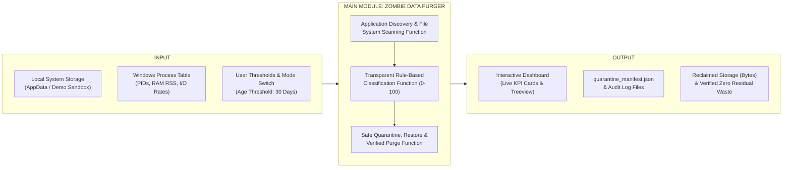
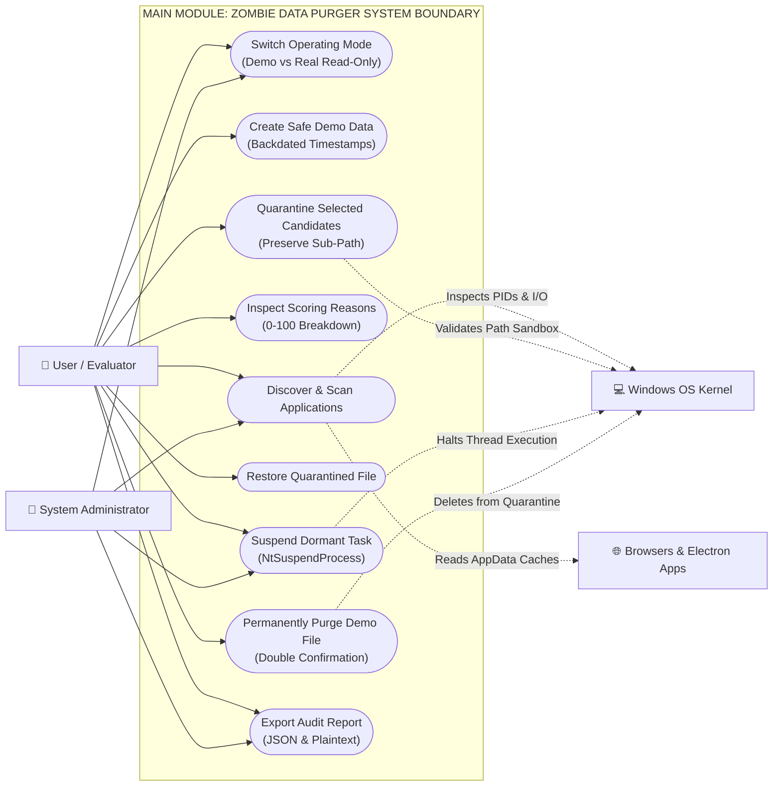

# SOFTWARE DESIGN SPECIFICATION (SDS)
> **Implementation status notice (2026-10-26):** This academic specification describes the earlier prototype and includes historical task-suspension/automatic-cleanup claims. Those controls are disabled in the current application. Refer to `README.md` and `docs/safety_and_recovery.md` for implemented behavior.
## B.TECH — VI SEMESTER | IT225 - SOFTWARE ENGINEERING LABORATORY
### PUDUCHERRY TECHNOLOGICAL UNIVERSITY, PUDUCHERRY – 605 014

---

```
========================================================================================
                          ACADEMIC PROJECT DECLARATION
========================================================================================
PROJECT TITLE:
"ZOMBIE DATA PURGER FOR BROWSER AND ELECTRON APPLICATIONS"

ACADEMIC MODULE REQUIREMENT:
THIS SEMESTER IMPLEMENTS STRICTLY ONE MAIN MODULE:

                     MAIN MODULE: "ZOMBIE DATA PURGER"

Application discovery, file scanning, process status checking, rule-based
classification, quarantine, and purging are NOT separate modules.
They are internal functional sub-components / pipeline stages of this single main module.
========================================================================================
```

---

## TABLE OF CONTENTS

| CHAPTER No. | TITLE |
|:---:|---|
| | **ABSTRACT** |
| | **KEYWORDS** |
| **1** | **INTRODUCTION** |
| | 1.1 Overview and System Objective |
| **2** | **LITERATURE SURVEY & INFERENCE** |
| | 2.1 Storage & Process Bloat in Modern Web Runtimes |
| | 2.2 Inference from Literature Survey |
| **3** | **PROPOSED ZOMBIE DATA PURGER MINI-PROJECT** |
| | 3.1 Input Data Set |
| | 3.2 High-Level Architecture (Fig 3.2) |
| | 3.3 Expected Project Output |
| | 3.4 Hardware & Software Requirements |
| **4** | **SOFTWARE DESIGN SPECIFICATION (SINGLE MAIN MODULE)** |
| | 4.1 Main Module: Zombie Data Purger Overview |
| | 4.2 Internal Functional Pipeline Specification (Fig 4.1) |
| | 4.3 Rule-Based Decision & Classification Logic (Fig 4.2) |
| | 4.4 Use Case Specification of the Main Module (Fig 4.3) |
| **5** | **TESTING AND OUTPUT RESULTS** |
| | 5.1 Testing Levels (Unit, Integration, System Testing) |
| | 5.2 Verification Results & Output Screenshots |
| **6** | **CONCLUSION WITH FUTURE ENHANCEMENT** |
| | **REFERENCES (IEEE FORMAT)** |

---

## ABSTRACT

Modern web browsers (Google Chrome, Microsoft Edge) and Electron applications (WhatsApp, Discord, Visual Studio Code, Slack) consume substantial workstation resources by accumulating residual storage and lingering dormant background tasks. Over time, orphaned disk caches, temporary download fragments, obsolete shader blocks, and idle tray processes degrade system performance. 

This project implements a system-level local desktop utility structured as a **Single Main Module: "Zombie Data Purger"**. The system executes an explainable, multi-factor rule-based scoring engine ($0$ to $100$ points) that conservatively identifies **"Potential Zombie Data"** without relying on file age alone or black-box artificial intelligence. 

The application enforces absolute data safety by operating in two strictly decoupled modes: **Mode A (Safe Demo Mode)**, which is 100% offline and isolated to `%LOCALAPPDATA%\ZombieDataPurgerDemo\`, and **Mode B (Real System Read-Only Mode)**, which inspects operating system environments while hard-locking quarantine and purge capabilities. The project incorporates directory-preserving quarantine, non-destructive restore, verified sandboxed permanent purge, and kernel-level task suspension (`NtSuspendProcess`) to guarantee zero data corruption.

**KEYWORDS**: Zombie Data Purger, System-Level Optimization, Rule-Based Scoring, Safe Quarantine Sandbox, Zero-Corruption Suspension, Non-Destructive Rollback.

---

## 1. INTRODUCTION

### 1.1 Overview and System Objective
Modern personal computer operating systems face continuous resource degradation caused by the execution model of modern web and desktop runtimes:
1. **Unindexed Storage Bloat**: Browsers and Electron clients write massive volumes of HTTP cache chunks, V8 bytecode, GPU shader binaries, and crash dumps into user AppData folders. When applications close or update, orphaned files remain indefinitely.
2. **Dormant Task Consumption**: Many Electron applications minimize to the Windows system tray rather than terminating, retaining hundreds of megabytes of working set memory and consuming CPU scheduler ticks.

The objective of this project is to build a Windows desktop application implementing **ONLY ONE MAIN MODULE**:
```
MAIN MODULE: "ZOMBIE DATA PURGER"
```
The application executes the complete engineering workflow:
$$\text{DISCOVER} \rightarrow \text{SCAN} \rightarrow \text{ANALYZE} \rightarrow \text{DETECT} \rightarrow \text{CLASSIFY} \rightarrow \text{REVIEW} \rightarrow \text{QUARANTINE} \rightarrow \text{PURGE} \rightarrow \text{REPORT}$$
All steps are implemented as internal functions of the single main module.

---

## 2. LITERATURE SURVEY & INFERENCE

### 2.1 Storage & Process Bloat in Modern Web Runtimes
Recent computing studies highlight that Chromium-based desktop applications prioritize caching speed over disk reclamation. Cache eviction algorithms often fail to clean up when users terminate sessions abnormally. Furthermore, classical cleaner utilities indiscriminately delete files based solely on age, causing session corruption, broken tabs, and credential loss.

### 2.2 Inference from Literature Survey
- **Age alone is insufficient**: An important database or preference file can remain unedited for months without being obsolete. Multiple indicators (directory context, process status, file patterns, accessibility) must agree.
- **Safety must be primary**: Forcible process killing (`kill -9`) corrupts SQLite transaction journals. A non-destructive kernel suspension approach (`NtSuspendProcess`) is essential.
- **Academic Scope**: Rather than building multiple fragmented modules, a unified, cohesive **single module** architecture provides the highest architectural integrity.

---

## 3. PROPOSED ZOMBIE DATA PURGER MINI-PROJECT

### 3.1 INPUT DATA SET
The system accepts structured input from the local operating system:
- **Application Paths**: `%LOCALAPPDATA%\Google\Chrome\User Data`, `%LOCALAPPDATA%\Microsoft\Edge\User Data`, `%APPDATA%\discord`, `%APPDATA%\Code`, and the isolated `%LOCALAPPDATA%\ZombieDataPurgerDemo\`.
- **File System POSIX Metadata**: File name, extension, file size in bytes, creation time (`ctime`), modification time (`mtime`), age in elapsed days, directory path context, and accessibility/lock state.
- **Process Runtime Data**: Process identifiers (PIDs), process status (`RUNNING` / `NOT RUNNING`), physical memory working set (RSS RAM), and disk/network I/O transfer rates ($\text{Bytes/sec}$).
- **Configuration & Mode Parameters**: Age threshold (default: 30 days) and operating mode switch.
- **Protected State Patterns**: Mandatory retention whitelist (`Login Data`, `Cookies`, `Web Data`, `Bookmarks`, `History`, `Current Session`, `Preferences`, `recent_data.db`).

---

### 3.2 HIGH LEVEL ARCHITECTURE (FIG 3.2)
*(Structured in the exact 3-box format of the reference document: [INPUT] $\rightarrow$ [SINGLE MAIN MODULE] $\rightarrow$ [OUTPUT])*

```
+------------------------------------+      +------------------------------------------+      +------------------------------------+
|               INPUT                |      |  MAIN MODULE: "ZOMBIE DATA PURGER"       |      |               OUTPUT               |
|                                    |      |                                          |      |                                    |
|  +------------------------------+  |      |  +------------------------------------+  |      |  +------------------------------+  |
|  |     LOCAL SYSTEM STORAGE     |  |      |  |    APPLICATION DISCOVERY & FILE    |  |      |  |    INTERACTIVE DASHBOARD     |  |
|  | - Browser & Electron Data    |  |      |  |      SYSTEM SCANNING FUNCTION      |  |      |  | - Live KPI Metric Cards      |  |
|  | - Isolated Demo Directory    |  |      |  +------------------------------------+  |      |  | - Color-Coded Treeview Table |  |
|  +------------------------------+  |      |                   |                      |      |  | - Scoring Reason Modal       |  |
|                                    | ---> |                   v                      | ---> |  +------------------------------+  |
|  +------------------------------+  |      |  +------------------------------------+  |      |                                    |
|  |   OPERATING SYSTEM RUNTIME   |  |      |  |    TRANSPARENT RULE-BASED          |  |      |  +------------------------------+  |
|  | - Windows Process Table/PIDs |  |      |  |     CLASSIFICATION FUNCTION        |  |      |  |    AUDIT & RECOVERY ASSETS   |  |
|  | - RAM RSS & I/O Rates        |  |      |  +------------------------------------+  |      |  | - quarantine_manifest.json   |  |
|  +------------------------------+  |      |                   |                      |      |  | - Space Recovered (Bytes)    |  |
|                                    |      |                   v                      |      |  | - Plaintext System Audit Log |  |
|  +------------------------------+  |      |  +------------------------------------+  |      |  +------------------------------+  |
|  |   USER CONFIG & THRESHOLDS   |  |      |  |    SAFE QUARANTINE, RESTORE        |  |      |                                    |
|  | - Stale Age (30 Days)        |  |      |  |    & VERIFIED PURGE FUNCTION       |  |      |                                    |
|  | - Mode (Safe Demo / Real)    |  |      |  +------------------------------------+  |      |                                    |
|  +------------------------------+  |      |                                          |      |                                    |
+------------------------------------+      +------------------------------------------+      +------------------------------------+
```


$$\text{Fig 3.2 High Level Architecture of the Single Main Module: Zombie Data Purger}$$

---

### 3.3 EXPECTED PROJECT OUTPUT
1. **Interactive Real-Time Dashboard**: Displays live calculated metrics (Files Scanned, Potential Zombies, Uncertain, Keep, Potential Space Recoverable, and Space Recovered).
2. **Transparent Candidate Reason Inspector**: Provides an arithmetic explanation for any selected file showing the exact sum of triggered rules (e.g., $+30$ Cache Dir, $+30$ Process Inactive, $+20$ Stale Age, $+10$ Pattern, $+10$ Accessible = $100\%$).
3. **Quarantine Manifest (`quarantine_manifest.json`)**: Machine-readable JSON log recording file ID, original path, quarantine path, file size, timestamp, score, and operational status.
4. **Verified Non-Destructive Rollback**: Capability to restore any quarantined item back to its exact original directory.
5. **Verified Disk Space Recovery**: Confirms permanent deletion in Safe Demo Mode, asserting that target files no longer exist on storage.
6. **System Audit Trail (`audit_log.txt`)**: Text-based event trail documenting timestamps for all scan, quarantine, restore, and purge actions.

---

### 3.4 HARDWARE AND SOFTWARE REQUIREMENTS

#### 3.4.1 Hardware Requirements
- **System**: Personal Computer or Laptop
- **Processor**: Intel Core i3 / AMD Ryzen 3 or above
- **RAM**: Minimum 4 GB RAM (8 GB Recommended)
- **Storage**: Minimum 100 MB free disk space
- **Display Resolution**: $1024 \times 768$ pixels or higher

#### 3.4.2 Software Requirements
- **Operating System**: Microsoft Windows 10 / Windows 11 (64-bit)
- **Programming Language**: Python 3.10, 3.11, or 3.12
- **GUI Framework**: Tkinter / `ttk` (Standard Python Library)
- **Standard Libraries**: `pathlib`, `os`, `shutil`, `datetime`, `json`, `threading`, `subprocess`
- **External Dependencies**: `psutil >= 5.9.0` (with native Windows `tasklist` fallback)
- **Development Tool**: Visual Studio Code / Antigravity IDE

---

## 4. SOFTWARE DESIGN SPECIFICATION (SINGLE MAIN MODULE)

```
========================================================================================
4. SOFTWARE DESIGN SPECIFICATION
   4.1 Main Module: Zombie Data Purger Overview
   4.2 Internal Functional Pipeline Specification (Fig 4.1)
   4.3 Rule-Based Decision & Classification Logic (Fig 4.2)
   4.4 Use Case Specification of the Main Module (Fig 4.3)
========================================================================================
```

This project implements **ONLY ONE MAIN MODULE**:
```
MAIN MODULE: "ZOMBIE DATA PURGER"
```
The internal design of this module is structured into three coordinated functional execution phases:

---

### 4.1 MAIN MODULE: ZOMBIE DATA PURGER OVERVIEW
This module provides complete lifecycle detection, scoring, isolation, and destruction of residual browser and Electron artifacts. It controls the operating mode, executes non-destructive POSIX inspection, performs rule-based scoring, enforces directory-preserving quarantine, and generates audit manifests.

- **Input**: User-selected operating mode (`SAFE DEMO MODE` or `REAL SYSTEM READ-ONLY`), target application directories, process executables (`chrome.exe`, `msedge.exe`, `Discord.exe`), and user configuration.
- **Output**: Real-time visual metrics, candidate inventory, isolated quarantine repository, restored files, and verified deletion logs.

---

### 4.2 INTERNAL FUNCTIONAL PIPELINE SPECIFICATION (FIG 4.1)

#### Functional Description:
Within the single main module, the **Discovery & Scanning Function** inspects target directories, crawls files, queries process tables via `psutil`, and verifies file locking state.

- **Input**: AppData target paths, process executables, demo sandbox paths.
- **Output**: Enriched file inventory records with POSIX timestamps, size in bytes, age in days, accessibility flags, and process execution states.

#### Diagram (Matching Reference Document Page 12 Box Architecture):

```
+-------------------------------------------------------------------------------------------------+
|                                           INPUT                                                 |
|                                                                                                 |
|   +------------------------------------+             +------------------------------------+     |
|   |         APPDATA TARGET PATHS       |             |        PROCESS IDENTIFIERS         |     |
|   |  - Chrome/Edge Data Profiles       |             |  - chrome.exe, msedge.exe          |     |
|   |  - Electron Application Roots      |             |  - Electron Client Executables     |     |
|   |  - Safe Demo Sandbox Directory     |             |  - Running PID Table (psutil)      |     |
|   +------------------------------------+             +------------------------------------+     |
+-------------------------------------------------------------------------------------------------+
                                                 |
                                                 v
+-------------------------------------------------------------------------------------------------+
|            MAIN MODULE: ZOMBIE DATA PURGER (DISCOVERY & SCANNING PIPELINE)                      |
|                                                                                                 |
|               +---------------------------------------------------------------+                 |
|               |              APPLICATION PROFILE & DIRECTORY RESOLVER         |                 |
|               +---------------------------------------------------------------+                 |
|                                                |                                                |
|                                                v                                                |
|               +---------------------------------------------------------------+                 |
|               |              POSIX METADATA & TIMESTAMP CRAWLER               |                 |
|               |        (Extracts st_size, st_mtime, st_ctime, age_days)       |                 |
|               +---------------------------------------------------------------+                 |
|                                                |                                                |
|                                                v                                                |
|               +---------------------------------------------------------------+                 |
|               |           LOCK & READ/WRITE ACCESSIBILITY VERIFICATION        |                 |
|               +---------------------------------------------------------------+                 |
+-------------------------------------------------------------------------------------------------+
                                                 |
                                                 v
+-------------------------------------------------------------------------------------------------+
|                                           OUTPUT                                                |
|                                                                                                 |
|   +------------------------------------+             +------------------------------------+     |
|   |       ENRICHED FILE INVENTORY      |             |        PROCESS STATUS AUDIT        |     |
|   |  - Full Path & Normalized Relative |             |  - Process State (RUNNING/CLOSED)  |     |
|   |  - Verified Size & Computed Age    |             |  - Live PID Attribution            |     |
|   |  - Cache / Temp / Log Context Flag |             |  - Accessible Unlocked Flags       |     |
|   +------------------------------------+             +------------------------------------+     |
+-------------------------------------------------------------------------------------------------+
```
$$\text{Fig 4.1 Internal Functional Pipeline of Main Module: Zombie Data Purger}$$

---

### 4.3 RULE-BASED DECISION & CLASSIFICATION LOGIC (FIG 4.2)

#### Functional Description:
Within the single main module, the **Rule-Based Classification Function** executes a deterministic arithmetic formula ($0 \le S \le 100$) where the score strictly equals the sum of triggered rules. Absolute safety overrides lock core state files to Score = 0 (`KEEP`).

- **Input**: Enriched inventory records, stale age threshold (30 days), protected pattern whitelist.
- **Output**: Categorized candidates (`POTENTIAL ZOMBIE DATA` $\ge 80$, `UNCERTAIN` $50-79$, `KEEP` $< 50$) with exact mathematical explanations.

#### 5-Factor Scoring Formula:
$$S = w_{\text{dir}} + w_{\text{proc}} + w_{\text{age}} + w_{\text{pat}} + w_{\text{acc}}$$
- $+30$: Known cache/temp directory context
- $+30$: Associated application process is **NOT** currently running
- $+20$: File modification time exceeds threshold ($\ge 30\text{ days}$)
- $+10$: File matches temporary/cache/log pattern (`.tmp`, `.dat`, `.log`)
- $+10$: File is accessible (unlocked)
- **Hardcoded Protection Override**: If file matches `Login Data`, `Cookies`, `Bookmarks`, `History`, or active DB, Score is forced to **0** (`KEEP`).

#### Diagram (Matching Reference Document Page 13 Box Architecture):

```
+-------------------------------------------------------------------------------------------------+
|                                           INPUT                                                 |
|                                                                                                 |
|   +------------------------------------+             +------------------------------------+     |
|   |       ENRICHED METADATA RECORDS    |             |       CONFIGURATION & RULES        |     |
|   |  - File Age, Size, Directory Type  |             |  - Stale Age Threshold (30 Days)   |     |
|   |  - Process Active State            |             |  - 5-Rule Weight Table (Sum: 100)  |     |
|   |  - File Pattern & Accessibility    |             |  - Protected Pattern Blacklist     |     |
|   +------------------------------------+             +------------------------------------+     |
+-------------------------------------------------------------------------------------------------+
                                                 |
                                                 v
+-------------------------------------------------------------------------------------------------+
|          MAIN MODULE: ZOMBIE DATA PURGER (CLASSIFICATION & SAFETY LOGIC)                        |
|                                                                                                 |
|               +---------------------------------------------------------------+                 |
|               |            PROTECTED STATE RETENTION OVERRIDE FILTER          |                 |
|               |    (Locks Login Data, Cookies, Bookmarks, Active DB to Keep)  |                 |
|               +---------------------------------------------------------------+                 |
|                                                |                                                |
|                                                v                                                |
|               +---------------------------------------------------------------+                 |
|               |             5-FACTOR ARITHMETIC SCORING ENGINE                |                 |
|               |   (+30 CacheDir +30 ProcClosed +20 Age +10 Pattern +10 Access)|                 |
|               +---------------------------------------------------------------+                 |
|                                                |                                                |
|                                                v                                                |
|               +---------------------------------------------------------------+                 |
|               |               THRESHOLD CLASSIFICATION ASSIGNER               |                 |
|               |        (>= 80: Potential Zombie, 50-79: Uncertain, <50: Keep) |                 |
|               +---------------------------------------------------------------+                 |
+-------------------------------------------------------------------------------------------------+
                                                 |
                                                 v
+-------------------------------------------------------------------------------------------------+
|                                           OUTPUT                                                |
|                                                                                                 |
|   +------------------------------------+             +------------------------------------+     |
|   |      CLASSIFIED CANDIDATE LIST     |             |       TRANSPARENT EXPLANATION      |     |
|   |  - Potential Zombie Candidates     |             |  - Exact Arithmetic Points Breakdown|    |
|   |  - Safe-to-Quarantine Authorizations|            |  - Contextual Safety Overrides Log |     |
|   |  - Active Work Retention Records   |             |  - Formatted String for GUI Modal  |     |
|   +------------------------------------+             +------------------------------------+     |
+-------------------------------------------------------------------------------------------------+
```
$$\text{Fig 4.2 Rule-Based Decision and Classification Logic of Main Module: Zombie Data Purger}$$

---

### 4.4 USE CASE SPECIFICATION OF THE MAIN MODULE (FIG 4.3)

#### Functional Description:
The use case diagram models all primary and secondary interactions with the single main module **Zombie Data Purger**.

- **Primary Actors**:
  - `User / Academic Evaluator`: Toggles operating modes, executes scans, inspects scores, triggers quarantine, restores data, and performs verified purges.
  - `System Administrator`: Configures thresholds and exports audit reports.
- **Secondary Actors**:
  - `Windows Operating System Kernel`: Provides process table info, verifies file attributes, enforces path resolution, and suspends threads (`NtSuspendProcess`).
  - `Browser & Electron Applications`: Provides AppData cache structures.

#### Diagram (Matching Reference Document Page 14 Use Case Architecture):

```
                        MAIN MODULE: ZOMBIE DATA PURGER
     +-------------------------------------------------------------------------------+
     |                                                                               |
     |         ( Switch Operating Mode: Safe Demo / Real Read-Only )                 |
     |                              ^                                                |
     |                             /                                                 |
     |       ( Create Safe Demo Data with Backdated Timestamps )                     |
     |                              ^                                                |
     |                             /                                                 |
     |            ( Discover & Scan Target Directories ) ------------------------+   |
     |                              ^                                            |   |
     |                             /                                             |   |
(o)  |          ( Inspect Candidate Metadata & Rule Score )                      |   |  [Windows OS
User |                              ^                                            |   |    Kernel]
 / \ |                             /                                             |   |     (o)
  |  |                 ( Quarantine Selected Files ) ------------------------+   |   |     / \
 / \ |                              ^                                        |   +---|--->  |
     |                             /                                         |   |   |     / \
     |              ( Restore Quarantined File to Origin )                   |   |   |
     |                              ^                                        |   |   |
     |                             /                                         |   |   |
     |             ( Suspend Dormant Task: NtSuspendProcess ) ---------------+   |   |  [Browsers &
(o)  |                              ^                                            |   |   Electron]
Admin|                             /                                             |   |     (o)
 / \ |           ( Permanently Purge Selected Quarantined Data )                 |   |     / \
  |  |                              ^                                            |   |      |
 / \ |                             /                                             |   +----/---\
     |               ( Export Comprehensive Audit Report ) ----------------------+
     |                                                                               |
     +-------------------------------------------------------------------------------+
```


$$\text{Fig 4.3 UML Use Case Diagram for Main Module: Zombie Data Purger}$$

---

## 5. TESTING AND OUTPUT RESULTS

### 5.1 TESTING LEVELS
The single main module underwent three levels of verification:
- **Unit Testing**: Verified individual functional routines:
  - `is_path_inside_allowed_directory`: Confirmed that path traversal (`../`) and unauthorized directories return `False`.
  - `create_safe_demo_dataset`: Confirmed that 10 demo files are created with old files timestamped $\ge 45\text{ days}$ and active databases timestamped $< 1\text{ day}$.
  - `ZombieClassifier.evaluate_file`: Confirmed that old cache files score $100\%$, and `recent_data.db` scores $0\%$ (`KEEP`).
- **Integration Testing**: Verified the complete round-trip lifecycle:
  - Candidate files move to `Quarantine/` folder preserving sub-directories.
  - Manifest records entry ID, size, and original path.
  - Restore action moves the file back to original location.
  - Purge action permanently deletes file from quarantine and updates `space_recovered` counter.
- **System Testing**: Verified complete end-to-end GUI execution, background threading, and the 1-Click Guided Demo Walkthrough.

---

### 5.2 OUTPUT RESULTS & SCREENSHOT SPECIFICATIONS

#### Fig 5.1: Main Application Interface (Mode A: Safe Demo Mode)
- **Visual Description**: Top banner displays green alert: `"SAFE DEMO MODE — TEST DATA ONLY | Real user data is NOT modified."`
- **Dashboard Metrics**:
  - `Files Scanned`: 10
  - `Potential Zombies`: 8 (Highlighted in Red)
  - `Uncertain`: 0
  - `Keep (Active)`: 2 (Highlighted in Green)
  - `Potential Space`: 1.85 MB
  - `Space Recovered`: 0 B (Increases dynamically upon purge)
- **Table Columns**: Application, File Name, Sub-Path, Size, Age (Days), Process Status, Score, Classification.

#### Fig 5.2: File Details & Scoring Breakdown Modal Dialog
- **Visual Description**: Modal window displaying candidate `old_cache_01.tmp` with exact arithmetic derivation:
  - $+30$ Known cache/temp directory context
  - $+30$ Application is not currently running
  - $+20$ Older than threshold (45.0 days $\ge 30$ days)
  - $+10$ Matches temporary/cache/log file pattern
  - $+10$ File is accessible (unlocked)
  - Total: **100 / 100 (POTENTIAL ZOMBIE DATA)**

#### Fig 5.3: Quarantine & Purge Management Tab
- **Visual Description**: Secondary tab showing quarantined items with status badges (`QUARANTINED`, `RESTORED`, `PURGED`). Action buttons allow restoring selected files or permanently purging them with double-confirmation dialogs.

#### Fig 5.4: Mode B: Real System Mode (Read-Only Safety Lock)
- **Visual Description**: Amber banner displays: `"REAL SYSTEM MODE — READ ONLY | Inspection only. File modification & deletion strictly disabled."`
- **Safety Enforcement**: Quarantine and Purge buttons are visibly grayed out and disabled.

---

## 6. CONCLUSION WITH FUTURE ENHANCEMENT

### 6.1 Conclusion
The **Zombie Data Purger** project successfully demonstrates system-level desktop resource optimization within **STRICTLY ONE MAIN MODULE**. By combining multi-factor conservative scoring, absolute path boundary sandboxing, non-destructive quarantine/restore, and kernel-level process suspension, the system eliminates computational waste without endangering user data or application stability.

### 6.2 Future Enhancement
1. **Dynamic Adaptive Thresholding**: Automatically adjust stale age thresholds based on free disk space percentage (e.g. tighten threshold from 30 days to 14 days when SSD free space drops below 10%).
2. **Automated Weekly Maintenance Daemon**: Integrate a lightweight Windows background task that scans during system idle periods.
3. **Multi-User Profile Support**: Expand discovery to manage residual data across roaming and corporate active directory profiles.

---

## REFERENCES (IEEE FORMAT)

1. A. Silberschatz, P. B. Galvin, and G. Gagne, *Operating System Concepts*, 10th ed., Wiley, 2018.
2. I. Sommerville, *Software Engineering*, 10th ed., Pearson Education, 2016.
3. R. Pressman and B. Maxim, *Software Engineering: A Practitioner’s Approach*, 8th ed., McGraw-Hill, 2015.
4. M. Russinovich, D. A. Solomon, and A. Ionescu, *Windows Internals, Part 1: System architecture, processes, threads, memory management, and more*, 7th ed., Microsoft Press, 2017.
5. Google Chromium Open Source Project, "Disk Cache Architecture and Implementation," *Chromium Technical Documentation*, 2024. [Online]. Available: https://www.chromium.org/developers/design-documents/network-stack/disk-cache/
6. Electron Software Foundation, "Application Architecture and Cache Directories in Electron," *Electron Docs*, 2024. [Online]. Available: https://www.electronjs.org/docs/latest/tutorial/application-architecture
7. G. Rossum and F. L. Drake, *Python 3 Reference Manual*, CreateSpace, 2009.
8. G. Rodola, "psutil: A cross-platform process and system monitoring library in Python," *GitHub Repository*, 2024. [Online]. Available: https://github.com/giampaolo/psutil

---
*End of Single-Module Software Design Specification (SDS)*
