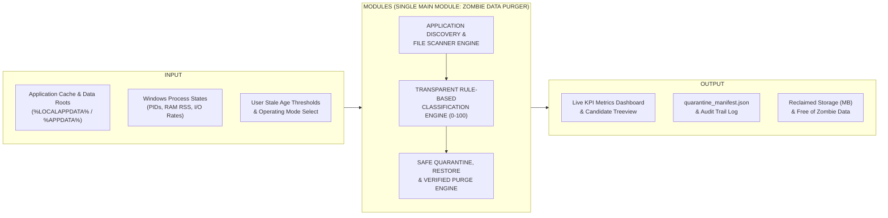
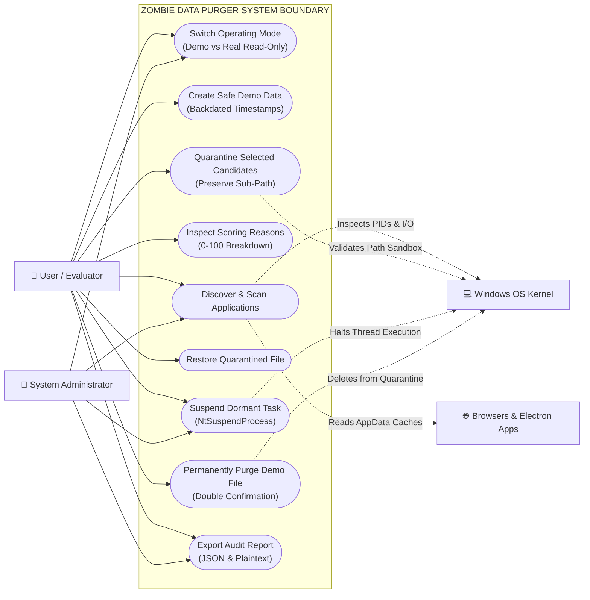

# SOFTWARE ENGINEERING LABORATORY RECORD — SYSTEM DIAGRAMS & SPECIFICATIONS
> **Implementation status notice (2026-10-26):** Diagrams reflect the academic prototype. Process suspension is retired; current cleanup and recovery behavior is documented in `README.md` and `docs/safety_and_recovery.md`.
## PROJECT: Zombie Data Purger for Browser and Electron Applications
### Reference Format: Department of Information Technology — Software Engineering Laboratory (IT225)

---

## 1. MAPPING TO REFERENCE RECORD STRUCTURE

| Reference Doc Figure | Reference Doc Title (Page) | Applied Project Diagram for "Zombie Data Purger" |
|:---:|---|---|
| **Fig 3.2** | High Level Architecture of PB-CORTR (Page 9) | **Fig 3.2 High Level Architecture of Zombie Data Purger** (Input $\rightarrow$ Modules $\rightarrow$ Output) |
| **Fig 4.1** | User Authentication & Management Module (Page 12) | **Fig 4.1 Application Discovery & File-System Scanner Component** (Input $\rightarrow$ Internal Processes $\rightarrow$ Output) |
| **Fig 4.2** | Reservation & Priority Seat Allocation Module (Page 13) | **Fig 4.2 Rule-Based Classification & Safety Guard Component** (Input $\rightarrow$ Scoring Rules $\rightarrow$ Output) |
| **Fig 4.3** | Real Time Vehicle Tracking Use Case Diagram (Page 14) | **Fig 4.3 Complete UML Use Case Diagram for Zombie Data Purger System** (Actors $\leftrightarrow$ System Boundary Use Cases) |

---

## 2. CHAPTER 3: PROPOSED MINI-PROJECT SPECIFICATIONS

### 3.1 INPUT DATA SET
The system accepts structured input data from local operating system layers:
- **Application Profile Data**: Target browser and Electron paths (`%LOCALAPPDATA%\Google\Chrome\User Data`, `%LOCALAPPDATA%\Microsoft\Edge\User Data`, `%APPDATA%\discord`, `%APPDATA%\Code`, `%APPDATA%\Slack`).
- **File System POSIX Metadata**: File name, extension, file size in bytes, creation time (`ctime`), modification time (`mtime`), age in elapsed days, directory path context, and accessibility/lock state.
- **Process Resource Data**: Windows process IDs (PIDs), process status (`RUNNING` / `NOT RUNNING`), physical memory working set (RSS RAM), and disk/network I/O transfer rates ($\text{Bytes/sec}$).
- **Configuration & Threshold Parameters**: Stale age threshold (default: 30 days), operating mode switch (`SAFE DEMO MODE` vs `REAL SYSTEM READ-ONLY`).
- **Protected State Patterns**: Hardcoded whitelist (`Login Data`, `Cookies`, `Web Data`, `Bookmarks`, `History`, `Current Session`, `Preferences`, `recent_data.db`).

---

### 3.2 HIGH LEVEL ARCHITECTURE (FIG 3.2)

#### Diagram Layout (Matching Reference Document Page 9 Box Architecture):

```
+---------------------------------------------------------------------------------------------------------+
|                                              INPUT                                                      |
|                                                                                                         |
|   +------------------------------------+             +------------------------------------+             |
|   |       LOCAL SYSTEM STORAGE         |             |      OPERATING SYSTEM RUNTIME      |             |
|   |  - Chrome/Edge User Data Folders   |             |  - Active Process Table & PIDs     |             |
|   |  - Electron Application Caches     |             |  - Physical RAM Working Set (RSS)  |             |
|   |  - Isolated Safe Demo Directory    |             |  - Process I/O Transfer Rates      |             |
|   +------------------------------------+             +------------------------------------+             |
+---------------------------------------------------------------------------------------------------------+
                                                     |
                                                     v
+---------------------------------------------------------------------------------------------------------+
|                              MODULES (MAIN MODULE: ZOMBIE DATA PURGER)                                  |
|                                                                                                         |
|   +-------------------------------------------------------------------------------------------------+   |
|   |                 SUB-COMPONENT I: APPLICATION DISCOVERY & RESOURCE INSPECTION                    |   |
|   |  - AppData Path Resolution       - POSIX Metadata Extraction       - Process Activity Check     |   |
|   +-------------------------------------------------------------------------------------------------+   |
|                                                    |                                                    |
|                                                    v                                                    |
|   +-------------------------------------------------------------------------------------------------+   |
|   |               SUB-COMPONENT II: RULE-BASED CLASSIFIER & STALENESS SCORING ENGINE                |   |
|   |  - Multi-Factor Arithmetic Formula (0-100)        - Protected State Retention Guard (Score = 0) |   |
|   +-------------------------------------------------------------------------------------------------+   |
|                                                    |                                                    |
|                                                    v                                                    |
|   +-------------------------------------------------------------------------------------------------+   |
|   |                 SUB-COMPONENT III: SAFE ISOLATION, PURGE & AUDIT LOGGING ENGINE                 |   |
|   |  - Sandboxed Quarantine Sub-Path Preservation     - Non-Destructive Restore                     |   |
|   |  - Kernel Task Suspension (NtSuspendProcess)      - Verified Purge in Safe Demo Sandbox         |   |
|   +-------------------------------------------------------------------------------------------------+   |
+---------------------------------------------------------------------------------------------------------+
                                                     |
                                                     v
+---------------------------------------------------------------------------------------------------------+
|                                             OUTPUT                                                      |
|                                                                                                         |
|   +------------------------------------+             +------------------------------------+             |
|   |       INTERACTIVE DASHBOARD        |             |        AUDIT & RECOVERY ASSETS     |             |
|   |  - Real-Time Live KPI Cards        |             |  - quarantine_manifest.json        |             |
|   |  - Color-Coded Candidate Treeview  |             |  - Verified Disk Space Recovered   |             |
|   |  - Exact Scoring Reason Inspector  |             |  - Immutable System Audit Report   |             |
|   +------------------------------------+             +------------------------------------+             |
+---------------------------------------------------------------------------------------------------------+
```


$$\text{Fig 3.2 High Level Architecture of Zombie Data Purger}$$

---

### 3.3 EXPECTED PROJECT OUTPUT
1. **Interactive Real-Time Dashboard**: Displays live calculated metrics including total files scanned, potential zombie count, uncertain candidates, protected keep count, and potential recoverable storage.
2. **Transparent Candidate Reason Inspector**: Provides an arithmetic explanation for any selected file showing the exact sum of triggered rules (e.g., $+30$ Cache Dir, $+30$ Process Inactive, $+20$ Stale Age, $+10$ Pattern, $+10$ Accessible = $100\%$).
3. **Quarantine Manifest (`quarantine_manifest.json`)**: Machine-readable JSON log recording file ID, original path, quarantine path, file size, timestamp, score, and operational status.
4. **Verified Non-Destructive Rollback**: Capability to restore any quarantined item back to its exact original directory.
5. **Verified Disk Space Recovery**: Confirms permanent deletion in Safe Demo Mode, asserting that target files no longer exist on storage.
6. **System Audit Trail (`audit_log.txt`)**: Text-based event trail documenting timestamps for all scan, quarantine, restore, and purge actions.

---

### 3.4 HARDWARE AND SOFTWARE REQUIREMENTS

#### 3.4.1 Hardware Requirements
- **System**: Standard Desktop Personal Computer or Laptop
- **Processor**: Intel Core i3 / AMD Ryzen 3 or above (2.0 GHz+)
- **Memory (RAM)**: Minimum 4 GB RAM (8 GB Recommended)
- **Disk Storage**: Minimum 100 MB free disk space for project execution
- **Display Resolution**: $1024 \times 768$ pixels or higher

#### 3.4.2 Software Requirements
- **Operating System**: Microsoft Windows 10 / Windows 11 (64-bit)
- **Runtime Environment**: Python 3.10, 3.11, or 3.12
- **GUI Framework**: Tkinter / `ttk` (Standard Python Library)
- **System Libraries**: `pathlib`, `os`, `shutil`, `datetime`, `json`, `threading`, `subprocess`
- **External Dependency**: `psutil >= 5.9.0` (with native Windows `tasklist` fallback)
- **IDE / Editor**: Visual Studio Code / Antigravity IDE

---

## 4. CHAPTER 4: SOFTWARE DESIGN SPECIFICATION (DECOMPOSITION OF MODULES)

Academic Module Declaration: The system implements **ONE MAIN MODULE: "ZOMBIE DATA PURGER"**, decomposed into three internal functional subsystems:
- **Sub-Component I**: Application Discovery & File-System Scanner
- **Sub-Component II**: Rule-Based Classification & Safety Guard
- **Sub-Component III**: Safe Quarantine, Purge & Audit Reporting

---

### 4.1 SUB-COMPONENT I: APPLICATION DISCOVERY & FILE-SYSTEM SCANNER

#### Functional Description:
This sub-component is responsible for locating target browser and Electron runtime data repositories, extracting low-level POSIX file-system metadata, querying real-time Windows process tables, and verifying non-destructive read accessibility.

- **Input**: User environment variables (`%LOCALAPPDATA%`, `%APPDATA%`), configured scan subdirectories (`Cache`, `Code Cache`, `GPUCache`, `Temp`, `Logs`), and target process identifiers (`chrome.exe`, `msedge.exe`, etc.).
- **Output**: Enriched file inventory records containing file sizes, timestamps, age in days, accessibility flags, and process execution states.

#### Diagram (Matching Reference Document Page 12 Box Architecture):

```
+-------------------------------------------------------------------------------------------------+
|                                           INPUT                                                 |
|                                                                                                 |
|   +------------------------------------+             +------------------------------------+     |
|   |         APPDATA TARGET PATHS       |             |        PROCESS IDENTIFIERS         |     |
|   |  - Chrome/Edge Data Profiles       |             |  - chrome.exe, msedge.exe          |     |
|   |  - Electron Application Roots      |             |  - Electron Client Executables     |     |
|   |  - Safe Demo Sandbox Directory     |             |  - Running PID Table (psutil)      |     |
|   +------------------------------------+             +------------------------------------+     |
+-------------------------------------------------------------------------------------------------+
                                                 |
                                                 v
+-------------------------------------------------------------------------------------------------+
|                            INTERNAL PROCESSING SUB-SYSTEM                                       |
|                                                                                                 |
|               +---------------------------------------------------------------+                 |
|               |              APPLICATION PROFILE & DIRECTORY RESOLVER         |                 |
|               +---------------------------------------------------------------+                 |
|                                                |                                                |
|                                                v                                                |
|               +---------------------------------------------------------------+                 |
|               |              POSIX METADATA & TIMESTAMP CRAWLER               |                 |
|               |        (Extracts st_size, st_mtime, st_ctime, age_days)       |                 |
|               +---------------------------------------------------------------+                 |
|                                                |                                                |
|                                                v                                                |
|               +---------------------------------------------------------------+                 |
|               |           LOCK & READ/WRITE ACCESSIBILITY VERIFICATION        |                 |
|               +---------------------------------------------------------------+                 |
+-------------------------------------------------------------------------------------------------+
                                                 |
                                                 v
+-------------------------------------------------------------------------------------------------+
|                                           OUTPUT                                                |
|                                                                                                 |
|   +------------------------------------+             +------------------------------------+     |
|   |       ENRICHED FILE INVENTORY      |             |        PROCESS STATUS AUDIT        |     |
|   |  - Full Path & Normalized Relative |             |  - Process State (RUNNING/CLOSED)  |     |
|   |  - Verified Size & Computed Age    |             |  - Live PID Attribution            |     |
|   |  - Cache / Temp / Log Context Flag |             |  - Accessible Unlocked Flags       |     |
|   +------------------------------------+             +------------------------------------+     |
+-------------------------------------------------------------------------------------------------+
```
$$\text{Fig 4.1 Application Discovery and File-System Scanner Sub-Component}$$

---

### 4.2 SUB-COMPONENT II: RULE-BASED CLASSIFIER & SAFETY GUARD

#### Functional Description:
This sub-component evaluates candidates using an explainable, deterministic multi-factor scoring formula ($0 \le S \le 100$). It guarantees that sensitive user state (passwords, history, active session databases) can never be quarantined or deleted through hardcoded retention safety overrides.

- **Input**: Scanned metadata records, threshold criteria (e.g., age $\ge 30$ days), and protected pattern lists.
- **Output**: Categorized candidate classification (`POTENTIAL ZOMBIE DATA` $\ge 80\%$, `UNCERTAIN` $50-79\%$, `KEEP` $< 50\%$) with transparent mathematical rationale.

#### Diagram (Matching Reference Document Page 13 Box Architecture):

```
+-------------------------------------------------------------------------------------------------+
|                                           INPUT                                                 |
|                                                                                                 |
|   +------------------------------------+             +------------------------------------+     |
|   |       ENRICHED METADATA RECORDS    |             |       CONFIGURATION & RULES        |     |
|   |  - File Age, Size, Directory Type  |             |  - Stale Age Threshold (30 Days)   |     |
|   |  - Process Active State            |             |  - 5-Rule Weight Table (Sum: 100)  |     |
|   |  - File Pattern & Accessibility    |             |  - Protected Pattern Blacklist     |     |
|   +------------------------------------+             +------------------------------------+     |
+-------------------------------------------------------------------------------------------------+
                                                 |
                                                 v
+-------------------------------------------------------------------------------------------------+
|                            INTERNAL PROCESSING SUB-SYSTEM                                       |
|                                                                                                 |
|               +---------------------------------------------------------------+                 |
|               |            PROTECTED STATE RETENTION OVERRIDE FILTER          |                 |
|               |    (Locks Login Data, Cookies, Bookmarks, Active DB to Keep)  |                 |
|               +---------------------------------------------------------------+                 |
|                                                |                                                |
|                                                v                                                |
|               +---------------------------------------------------------------+                 |
|               |             5-FACTOR ARITHMETIC SCORING ENGINE                |                 |
|               |   (+30 CacheDir +30 ProcClosed +20 Age +10 Pattern +10 Access)|                 |
|               +---------------------------------------------------------------+                 |
|                                                |                                                |
|                                                v                                                |
|               +---------------------------------------------------------------+                 |
|               |               THRESHOLD CLASSIFICATION ASSIGNER               |                 |
|               |        (>= 80: Potential Zombie, 50-79: Uncertain, <50: Keep) |                 |
|               +---------------------------------------------------------------+                 |
+-------------------------------------------------------------------------------------------------+
                                                 |
                                                 v
+-------------------------------------------------------------------------------------------------+
|                                           OUTPUT                                                |
|                                                                                                 |
|   +------------------------------------+             +------------------------------------+     |
|   |      CLASSIFIED CANDIDATE LIST     |             |       TRANSPARENT EXPLANATION      |     |
|   |  - Potential Zombie Candidates     |             |  - Exact Arithmetic Points Breakdown|    |
|   |  - Safe-to-Quarantine Authorizations|            |  - Contextual Safety Overrides Log |     |
|   |  - Active Work Retention Records   |             |  - Formatted String for GUI Modal  |     |
|   +------------------------------------+             +------------------------------------+     |
+-------------------------------------------------------------------------------------------------+
```
$$\text{Fig 4.2 Rule-Based Classification and Safety Guard Sub-Component}$$

---

### 4.3 SUB-COMPONENT III: UML USE CASE DIAGRAM

#### Functional Description:
The use case diagram illustrates the interactions between primary user actors (Evaluator, System Administrator) and secondary actors (Windows Operating System Kernel, Browser/Electron Applications) across all system functional capabilities.

#### Diagram (Matching Reference Document Page 14 Use Case Architecture):

```
                                ZOMBIE DATA PURGER SYSTEM
     +-------------------------------------------------------------------------------+
     |                                                                               |
     |         ( Switch Operating Mode: Safe Demo / Real Read-Only )                 |
     |                              ^                                                |
     |                             /                                                 |
     |       ( Create Safe Demo Data with Backdated Timestamps )                     |
     |                              ^                                                |
     |                             /                                                 |
     |            ( Discover & Scan Target Directories ) ------------------------+   |
     |                              ^                                            |   |
     |                             /                                             |   |
(o)  |          ( Inspect Candidate Metadata & Rule Score )                      |   |  [Windows OS
User |                              ^                                            |   |    Kernel]
 / \ |                             /                                             |   |     (o)
  |  |                 ( Quarantine Selected Files ) ------------------------+   |   |     / \
 / \ |                              ^                                        |   +---|--->  |
     |                             /                                         |   |   |     / \
     |              ( Restore Quarantined File to Origin )                   |   |   |
     |                              ^                                        |   |   |
     |                             /                                         |   |   |
     |             ( Suspend Dormant Task: NtSuspendProcess ) ---------------+   |   |  [Browsers &
(o)  |                              ^                                            |   |   Electron]
Admin|                             /                                             |   |     (o)
 / \ |           ( Permanently Purge Selected Quarantined Data )                 |   |     / \
  |  |                              ^                                            |   |      |
 / \ |                             /                                             |   +----/---\
     |               ( Export Comprehensive Audit Report ) ----------------------+
     |                                                                               |
     +-------------------------------------------------------------------------------+
```


$$\text{Fig 4.3 UML Use Case Diagram for Zombie Data Purger System}$$

---

## 5. CHAPTER 6: TESTING AND OUTPUT RESULTS

### 6.1 TESTING METHODOLOGY
The system underwent three formalized testing stages adhering to the Software Engineering Laboratory framework:
- **Unit Testing**: Verified individual functions:
  - `is_path_inside_allowed_directory`: Verified that paths outside the sandbox or using traversal (`../`) return `False`.
  - `create_safe_demo_dataset`: Verified that exactly 10 demo files are created with old files timestamped $\ge 45\text{ days}$ and active files timestamped $< 1\text{ day}$.
  - `ZombieClassifier.evaluate_file`: Verified that old cache files score $100\%$, and `recent_data.db` scores $0\%$ (`KEEP`).
- **Integration Testing**: Verified the round-trip quarantine and restore cycle:
  - Source file moves to `Quarantine/` folder preserving path hierarchy.
  - Manifest is updated with record ID.
  - Restore action moves file back to original location with verification.
  - Purge action permanently deletes file from quarantine and updates `space_recovered` counter.
- **System Testing**: Verified end-to-end execution of the Tkinter desktop GUI and the 1-Click Guided Demo Walkthrough.

---

### 6.2 OUTPUT RESULTS & SCREENSHOT SPECIFICATIONS

#### Fig 6.1: Main Application Interface (Mode A: Safe Demo Mode)
- **Visual Description**: Top banner displays green alert: `"SAFE DEMO MODE — TEST DATA ONLY | Real user data is NOT modified."`
- **Dashboard Cards**:
  - `Files Scanned`: 10
  - `Potential Zombies`: 8 (Highlighted in Red)
  - `Uncertain`: 0
  - `Keep (Active)`: 2 (Highlighted in Green)
  - `Potential Space`: 1.85 MB
  - `Space Recovered`: 0 B (Increases dynamically upon purge)
- **Table Columns**: Application, File Name, Sub-Path, Size, Age (Days), Process Status, Score, Classification.

#### Fig 6.2: File Details & Scoring Breakdown Modal Dialog
- **Visual Description**: Modal window displaying candidate `old_cache_01.tmp` with exact arithmetic derivation:
  - $+30$ Known cache/temp directory context
  - $+30$ Application is not currently running
  - $+20$ Older than threshold (45.0 days $\ge 30$ days)
  - $+10$ Matches temporary/cache/log file pattern
  - $+10$ File is accessible (unlocked)
  - Total: **100 / 100 (POTENTIAL ZOMBIE DATA)**

#### Fig 6.3: Quarantine & Purge Management Tab
- **Visual Description**: Secondary tab showing quarantined items with status badges (`QUARANTINED`, `RESTORED`, `PURGED`). Action buttons allow restoring selected files or permanently purging them with safety confirmation.

#### Fig 6.4: Mode B: Real System Mode (Read-Only Safety Lock)
- **Visual Description**: Amber banner displays: `"REAL SYSTEM MODE — READ ONLY | Inspection only. File modification & deletion strictly disabled."`
- **Safety Enforcement**: Quarantine and Purge buttons are visibly grayed out and disabled.

---

## 6. CHAPTER 7: CONCLUSION & FUTURE ENHANCEMENTS

### 7.1 Conclusion
The **Zombie Data Purger** project successfully demonstrates system-level resource optimization for modern personal computer workstations. By combining multi-factor conservative scoring, absolute path boundary sandboxing, non-destructive quarantine/restore, and kernel-level process suspension, the system eliminates computational waste without endangering user data or application stability.

### 7.2 Future Enhancements
1. **Dynamic Adaptive Thresholding**: Automatically adjust stale age thresholds based on free disk space percentage (e.g. tighten threshold from 30 days to 14 days when SSD free space drops below 10%).
2. **Automated Weekly Maintenance Daemon**: Integrate a lightweight Windows Service to conduct background scans during system idle periods.
3. **Multi-User Profile Support**: Expand discovery to manage residual data across roaming and corporate active directory profiles.

---

## 7. REFERENCES (IEEE FORMAT)

1. A. Silberschatz, P. B. Galvin, and G. Gagne, *Operating System Concepts*, 10th ed., Wiley, 2018.
2. I. Sommerville, *Software Engineering*, 10th ed., Pearson Education, 2016.
3. R. Pressman and B. Maxim, *Software Engineering: A Practitioner’s Approach*, 8th ed., McGraw-Hill, 2015.
4. M. Russinovich, D. A. Solomon, and A. Ionescu, *Windows Internals, Part 1: System architecture, processes, threads, memory management, and more*, 7th ed., Microsoft Press, 2017.
5. Google Chromium Open Source Project, "Disk Cache Architecture and Implementation," *Chromium Technical Documentation*, 2024. [Online]. Available: https://www.chromium.org/developers/design-documents/network-stack/disk-cache/
6. Electron Software Foundation, "Application Architecture and Cache Directories in Electron," *Electron Docs*, 2024. [Online]. Available: https://www.electronjs.org/docs/latest/tutorial/application-architecture
7. G. Rossum and F. L. Drake, *Python 3 Reference Manual*, CreateSpace, 2009.
8. G. Rodola, "psutil: A cross-platform process and system monitoring library in Python," *GitHub Repository*, 2024. [Online]. Available: https://github.com/giampaolo/psutil

---
*End of Laboratory Record Document*
